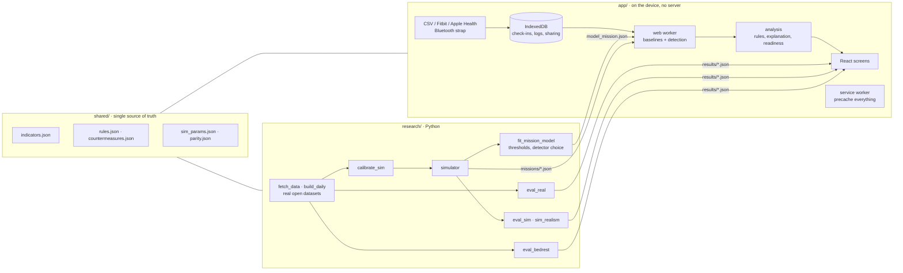

# Keel

**A crew health monitor that keeps working when Earth cannot answer.**

**Live demo: https://aarav-agarwal331.github.io/keel-crew-health/**


Try it in 60 seconds:

1. Open the live demo. You are on a crew member's tablet during a simulated Mars transit, in a link blackout.
2. Tap **Watch it catch an event** and press Play.
3. Tap **The evidence** to see how well it works on real data, and what it cannot do.

On the International Space Station a flight surgeon on Earth watches crew health in near real time.
On the way to Mars the signal takes up to about 24 minutes each way and sometimes there is no link at
all. Keel runs entirely on the crew member's own device: it learns each person's own normal, notices
drift, says what changed in plain language, and recommends one action tied to a documented
countermeasure. The crew member owns the data and decides what the medical officer, the commander and
the ground can see.

Built for the 2026 NASA Space Apps Challenge, *Create Health Monitoring Software for Astronauts on
Space Missions*. Keel is an independent project. It is not a NASA product, is not endorsed by NASA, and
is decision support, not a medical device.

## What is different

- **No server, no link required.** Offline-first installable web app; all analysis runs in a web
  worker on the device. An automated test cuts the network and uses every screen.
- **Measured, not asserted.** Detection is evaluated on real wearable data with dated illness
  (251 people, 107 episodes), with false-alert rates, intervals, a chance level and held-out people.
  The app shows the results, including where a simple method does as well and what is *not* shown.
- **Safety rules that do not wait for a trend.** Red-flag symptoms and single readings beyond a
  sourced threshold are acted on at once.
- **Alarm fatigue treated as a hazard.** Thresholds come from an explicit false-alert budget.
- **Auditable advice.** A fixed table of 32 rules maps patterns, entered readings and reported
  symptoms to cited countermeasures, each with how soon and who. No language model writes medical text.
- **Crew-owned data.** Per-role, per-area sharing with an access log; the commander sees readiness,
  not reasons.

## Headline results

Detection is reported **above luck**: at one false alert per person-month an alert falls inside a
two-week window by chance about a third of the time, so that share is measured and subtracted.

| Real wearable data: 251 people, 107 dated illness episodes, held-out people | Keel | One threshold for everyone |
|---|---|---|
| Episodes flagged at 1 false alert per person-month | 66% (luck 36%) | 41% (luck 25%) |
| **Above luck** (95% interval) | **+30 points** (20 to 40) | +17 points (7 to 27) |
| Keel's advantage, above luck | +14 points (0 to 28) | |
| At the stricter tier, 0.25 false alerts per person-month | +32 (22 to 42) with daily steps; +12 (3 to 20) with the 7-day activity average the app itself uses | +9 (3 to 17) |
| Measured false alerts per person-month (budget 1.00) | 0.99 with thresholds from other real people; 1.38 with thresholds from simulation only | |

| Other evidence | Result |
|---|---|
| Simulated missions, full sensor set, 1 false alert per person-month | 67% flagged (luck 40%): +26 above luck (20 to 33) |
| Gravity transitions, real NASA bed-rest data, 14 volunteers | false flags after getting up: 9 with a plain personal baseline, 4 with Keel (p = 0.06) |

Honest reading:

- **No early warning.** On real data the alert usually starts on or just after the day symptoms begin
  (39% had an alert start in the ten days up to onset; luck gives 29%).
- **Most alerts are false.** At in-flight illness rates, between one alert in 11 and one in 28 at the
  strict tier would be a real respiratory illness.
- **Much of the signal is behavioural.** Heart rate alone is +17 above luck; steps add the rest,
  because people move less once they feel ill.
- **The four personal-baseline detectors perform alike.** A simple two-of-three-days rule is +27. The
  rule that picked the deployed detector was written during review and the choice flipped once.
- **Handling gravity changes halves false alerts after launch but hides real problems** in the first
  weeks (+20 against +35 above luck in simulation).
- **Simulation is not reality.** Thresholds calibrated in simulation ran 38% over budget on real people
  with two indicators and up to nearly four times over with five. The simulator fails three of its own
  pass marks (HRV variability, sleep carry-over, size of the illness heart-rate rise).
- The real data is from people on Earth with two indicators. Everything beyond illness is tested in
  simulation only.

Details: the app's Validation screen, [docs/METHOD.md](docs/METHOD.md) and [docs/REVIEW.md](docs/REVIEW.md).

## Quickstart

Requirements: [uv](https://docs.astral.sh/uv/) and Node 20 or newer. No accounts are needed.

```bash
make setup      # Python and Node dependencies
make dev        # run the app at http://localhost:5173 with the committed data and results
```

To reproduce every number from a clean clone (downloads about 1.7 GB of open data):

```bash
make all        # data -> sim -> model -> validate -> test -> build
make e2e        # offline end-to-end test against the production build
```

| Target | What it does |
|---|---|
| `make data` | Downloads the open datasets (range requests, nothing whole that is not needed) and reduces them to daily features |
| `make sim` | Calibrates the simulator on a calibration half of the real people, then writes the demo missions |
| `make model` | Fits correlations and thresholds on simulated training missions, chooses the detector, writes parity vectors |
| `make validate` | Real-data evaluation, simulated evaluation, simulator realism, NASA bed-rest check |
| `make test` | Python and TypeScript unit tests, including Python-to-TypeScript detector parity |
| `make build` | Production build with the offline cache |
| `make e2e` | Loads the build, disables the network, exercises every screen |
| `make deploy` | Publishes `app/dist` to GitHub Pages (needs `gh auth login`) |

## Architecture



- `research/keel/`: `simulator.py`, `core.py` (baselines and detectors), `evaluate.py` (protocol),
  `realdata.py` (loaders).
- `app/src/core/`: `detect.ts` (the TypeScript twin of `core.py`, held by a parity test),
  `analysis.ts` (rules and explanations), `visibility.ts` (the privacy gate), `link.ts`,
  `readiness.ts`, `importers.ts`, `ble.ts`.
- `shared/`: indicator definitions, the alert-to-action rule table, countermeasures with sources,
  simulator parameters with provenance.

## Requirement traceability

Requirement IDs are from [docs/REQUIREMENTS.md](docs/REQUIREMENTS.md), which quotes the official
statement saved in [docs/CHALLENGE.md](docs/CHALLENGE.md).

| ID | Requirement | Where to see it |
|---|---|---|
| A1 | Gathers health indicators | 17 indicators; wearable import, Bluetooth strap, check-in, cabin sensors (Data sources, Check-in) |
| A2 | Astronauts evaluate their own health | Today status against a personal baseline; Trends; body map |
| A3 | Act on it; guidance on treatments and improvements | One recommended action on Today; Alert detail with steps and cited countermeasures; Guide → "Everything Keel can recommend" (all 32 rules) |
| A4 | A visual tool | Charts with personal bands, clickable body map, replay |
| A5 | Any input: keyboard, clicks, files | Check-in taps and number entry; file import; live sensor. Camera input is not done |
| A6 | Data represents a health indicator, with units | Units on every reading and entry field (for example blood sugar in mg/dL) |
| A7 | Blood pressure, heart rate, blood sugar, temperature, sleep hours, mood | All six are indicators; blood pressure, blood sugar and thermometer readings have fixed safety rules with sourced reference values |
| A8 | Immune changes, bone loss, cardiovascular events, nutrition, behavioral health | Illness-pattern rule; exercise adherence for bone and muscle; heart indicators; food and fluid logs; mood and reaction test |
| A9 | Grounded in the five hazards | Guide → five hazards table; body map "why space matters here" |
| A10 | Uses NASA HRP and other agencies' resources | docs/DOMAIN.md (62 opened sources); Method → Sources |
| B1 | Which measurements can be performed in space? | Guide; DOMAIN.md section 3 |
| B2 | Why is an exam needed? | "Why it matters" on every indicator (Trends, Guide) |
| B3 | How do hazards affect indicators? | Guide; body map; simulator adaptation model |
| B4 | When does a result warrant crew or flight-surgeon attention? | "How soon" and "who" on every alert; red-flag symptoms and safety thresholds that bypass the detector; Guide → "When to involve someone else" |
| B5 | Actions that prevent a critical condition | Rule table mapped to countermeasures (Method → From alert to action) |
| B6 | Clear UI with animation and interactivity | Replay, hover readouts on every chart, status by colour, shape and words |
| B7 | Clickable human figure | Today → "Your body at a glance" |
| C1 | Different environments | Mars transit and lunar surface missions (gravity change, radiation, link delay differ) |
| C2 | Prompts to measure as part of routine | Today → "Today's routine" with due measurements |
| C3 | Gamification | Streak, weekly exercise ring, shared crew exercise goal (deliberately light) |
| C4 | Dynamic charts over time | Trends: 2 weeks, 8 weeks, mission |
| C5 | Colour coding at a glance | Four status levels, each with a colour, a shape and a label (colourblind-safe) |
| C6 | Instructions and explanations | "How to measure" on every entry field; Guide |
| D3 | Official Resources tab | Opens 2026-11-13; **not done**, needs a human check |
| E1 | Works with no link, offline proven | `app/e2e/offline.spec.ts`; Link → "Cut the link now" |
| E2 | Personal baselines; adaptation not flagged as illness | Method → Personal baselines; Validation sections 2 and 4 |
| E3 | Detection measured on real labeled data | Validation section 1 |
| E4 | Simulation labelled | "Simulated data" chip on every screen that shows it |
| E5 | Auditable alert-to-action | Alert detail → audit trail; `shared/rules.json` |
| E6 | Crew-owned data, access log | Sharing |
| E7 | Privacy-preserving readiness | Crew (tier never better than the crew member's own worst area; reasons only if shared) |
| E8 | Link delay, blackout, queued summary | Link |
| E9 | Mission replay | Replay |
| E10 | Decision support, not diagnosis | Stated on Today, Alert, More; enforced by a unit test on the rule text |

## Data credits

Raw data is not redistributed in this repository; `make data` downloads it from the original sources.

- **Stanford COVID-19 wearables, phase 1.** Mishra T, Wang M, Metwally AA, et al. Pre-symptomatic
  detection of COVID-19 from smartwatch data. *Nat Biomed Eng* 4, 1208–1220 (2020).
  https://doi.org/10.1038/s41551-020-00640-6. No explicit data licence; the article states the
  de-identified data can be downloaded from the study repository.
- **Stanford COVID-19 wearables, phase 2.** Alavi A, Bogu GK, Wang M, et al. Real-time alerting system
  for COVID-19 and other stress events using wearable data. *Nat Med* 28, 175–184 (2022).
  https://doi.org/10.1038/s41591-021-01593-2. Same terms.
- **LifeSnaps.** Yfantidou S, Karagianni C, Efstathiou S, et al. LifeSnaps, a 4-month multi-modal
  dataset capturing unobtrusive snapshots of our lives in the wild. *Sci Data* 9, 663 (2022).
  https://doi.org/10.5281/zenodo.7229547. CC BY 4.0.
- **NASA Life Sciences Data Archive**, public head-down-tilt bed-rest campaigns (UTMB Flight Analogs
  Research Unit, campaigns 1, 3 and CFT70), via the NASA Life Sciences Portal, https://nlsp.nasa.gov/.
- Domain sources: [docs/DOMAIN.md](docs/DOMAIN.md). Data survey: [docs/DATA.md](docs/DATA.md).

## Documents

[PLAN.md](PLAN.md) · [DECISIONS.md](DECISIONS.md) · [docs/METHOD.md](docs/METHOD.md) ·
[docs/DOMAIN.md](docs/DOMAIN.md) · [docs/DATA.md](docs/DATA.md) ·
[docs/REQUIREMENTS.md](docs/REQUIREMENTS.md) · [submission/](submission/) ·
[docs/REVIEW.md](docs/REVIEW.md) · [FINAL_REPORT.md](FINAL_REPORT.md) · screenshots in [docs/shots/](docs/shots/)

## License

MIT, see [LICENSE](LICENSE). No NASA logos or insignia are used.
