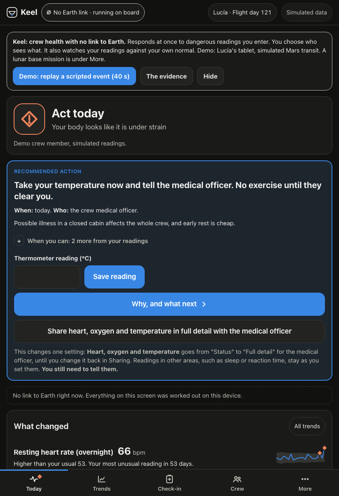
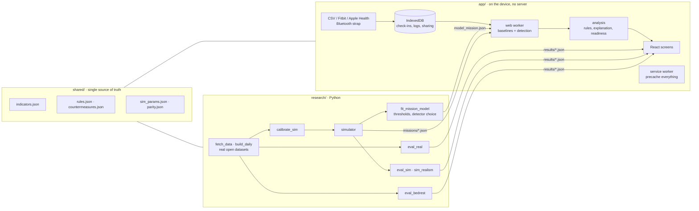

# Keel

**A crew health monitor that keeps working when Earth cannot answer.**

**Live demo: https://aarav-agarwal331.github.io/keel-crew-health/**



Try it in 60 seconds:

1. Open the live demo. You are on a crew member's tablet during a simulated Mars transit, in a link blackout.
2. Tap **Demo: replay a scripted event** and press Play.
3. Tap **The evidence** to see how well it works on real data, and what it cannot do.

On the International Space Station a flight surgeon is seconds away by voice and talks privately with
each crew member about once a week; routine vital signs are not streamed to the ground. On the way to
Mars the signal takes up to about 24 minutes each way and sometimes there is no link at all, so
medical decisions have to move on board. Keel runs entirely on the crew member's own device: it learns
each person's own normal, notices drift, says what changed in plain language, and recommends one
action tied to a documented countermeasure. The crew member owns the data and decides what the
medical officer, the commander and the ground can see.

Built for the 2026 NASA Space Apps Challenge, *Create Health Monitoring Software for Astronauts on
Space Missions*. Keel is an independent project. It is not a NASA product, is not endorsed by NASA, and
is decision support, not a medical device.

## In one paragraph

Keel works with no link to Earth, acts at once on dangerous readings and symptoms with a written next
step and its source, and lets the crew member choose who sees what. It also watches each person's
readings against their own normal. On 107 real illness episodes, overnight heart rate alone flagged
**+13 points above luck (4 to 24) in the detection window we set before the analysis, and +19 (9 to
28) in the narrower window we moved to while writing it** (50% flagged against 31% by chance in the
narrower one), at about one false alert a month;
that is the model imported watch data runs on (on Fitbit's
own daily resting heart rate it gives about one alert a month, as budgeted, and about a fifth over its
budget at the alert tier). The full on-board model is tested in simulation only.
Useful early warning was not shown, most alerts are false, and Keel's detector is itself a simple
personal rule, because a more complex one did not earn its place on the simulated training missions. Its main contribution is the offline safety, sharing and action loop; detection is one
input to it.

## What is different

- **No server, no link required.** Offline-first installable web app; all analysis runs in a web
  worker on the device. An automated test cuts the network and uses every screen.
- **Measured, not asserted.** Detection is evaluated on real wearable data with dated illness
  (251 people, 107 episodes), with false-alert rates, intervals, a chance level and held-out people.
  The app shows the results, including where a simple method does as well and what is *not* shown.
- **Safety rules that do not wait for a trend.** Red-flag symptoms and single readings beyond a
  sourced (or marked provisional) threshold are acted on at once. Every reading is kept with its time, the worst one counts,
  and anything urgent stays on the medical officer's list until they close it with a note.
- **Alarm fatigue treated as a hazard.** Thresholds come from an explicit false-alert budget.
- **Auditable advice.** A fixed table of 45 rules maps patterns, entered readings and reported
  symptoms to cited countermeasures, each with how soon and who. No language model writes medical text.
- **Crew-owned data.** Per-role, per-area sharing with an access log; the commander sees readiness,
  not reasons, and some symptoms go to the medical officer only.

## Headline results

Detection is reported **above luck**: at one false alert per person-month an alert falls inside a
two-week window by chance about a third of the time, so that share is measured and subtracted.

Real wearable data: 251 people, 107 dated illness episodes (Stanford COVID-19 wearables), two sensors
(overnight heart rate and activity).

| Configuration, notice tier | Flagged | By luck | **Above luck** (95% interval) | False alerts per person-month |
|---|---|---|---|---|
| **Heart rate alone, thresholds from other real people (the import model), originally planned window** | 56% | 43% | **+13 (4 to 24)** | 0.99 |
| … the same, in the narrower window used elsewhere in this table | 50% | 31% | +19 (9 to 28) | 0.99 |
| Heart rate + 7-day activity, thresholds from other real people (5-fold over people) | 64% | 34% | +30 (20 to 39) | 0.99 |
| Heart rate + daily steps, thresholds from other real people | 63% | 34% | +28 (19 to 38) | 0.98 |
| One fixed threshold for everyone, heart rate + daily steps | 41% | 23% | +18 (8 to 27) | 1.01 |
| One fixed threshold for everyone, heart rate + 7-day activity | 26% | 19% | +7 (−1 to 15) | 1.01 |
| The 11-channel model file the app ships, given only the channels a real import has | 29% | 13% | +16 (7 to 25) | 0.35 |
| Linking analysis (over its false-alert budget, so not comparable with the rows above): Keel's method on two sensors (heart rate + 7-day activity), thresholds set only in simulation | 68% | 41% | +28 (18 to 37) | 1.31 (budget 1.00, over) |
| … on the 132 people the simulator's fits did not use (60 episodes) | 72% | 41% | +30 (17 to 42) | 1.29 |

| Stricter tier (the one that brings in the medical officer), budget 0.25 | Above luck | False alerts per person-month |
|---|---|---|
| Keel's method, two sensors, simulator thresholds | +24 (14 to 34) | 0.41 |
| Thresholds from other real people, heart rate + 7-day activity | never fires (its threshold lands on the z-score cap of 4): no episodes flagged | 0.00 |
| … heart rate + daily steps | +26 (17 to 35) | 0.25 |
| The shipped model file, real-import channels only | +10 (4 to 17) | 0.12 |

| Other evidence | Result |
|---|---|
| Simulated missions, full sensor set, 1 false alert per person-month | 71% flagged (luck 41%): +31 above luck (25 to 36). By event type: sleep restriction +57, exercise outage +51, low fluids +44 (30 to 54), cabin CO2 +16 (6 to 24), illness +14 (−6 to 34) at the notice tier and +11 (−2 to 27) at the alert tier, both intervals including zero, low mood +17 (−3 to 36) |
| Events in the first 25 flight days, luck taken from the same flight days | +22 (13 to 31) with gravity-phase handling, +18 (8 to 29) without |
| Gravity transitions, real NASA bed-rest pulse data, 14 volunteers | flags after getting up: 9 with a plain personal baseline, 4 with a pulse-only rule with phase handling (a 2-of-3 rule, not the full detector). The same rule flags 35% of 14-day stretches away from any transition (11 of 31): the plain baseline's 9 of 14, though higher, is not distinguishable from it (p about 0.1); the phase-handling variant's own chance level with its widened band was not measured. Not significant (exact paired p = 0.06), no ground truth that those flags are false, and the fewer flags come from widening the band |

Honest reading:

- **No useful early warning shown.** At the notice tier an alert started in the ten days up to onset
  for 44% of episodes against 30% by luck (+14, 4 to 24) in the two-sensor linking analysis; for heart
  rate alone +14 (5 to 23). At the alert tier +6 (−1 to 13) for the linking analysis, an interval that
  includes zero, and +7 (0 to 14) for heart
  rate alone; both windows include the day of onset itself. The
  notice-tier gain is small and confounded by test dates, isolation and lower activity, so we do not
  claim early warning.
- **Most alerts are false.** At in-flight illness rates, about one alert in 20 at the alert tier would be
  attributable to a real respiratory illness for the import model on the watch maker's own resting
  heart rate, as imports carry it, assuming detection carries over unchanged (not measured; 1 in 16 on night-time heart rate), and one in 22 for the two-sensor
  simulator-threshold version (one in 13 for a daily-steps configuration the app does not run). All are likely optimistic estimates.
- **Imported watch data uses its own model.** Because of the next point, the app runs imports on a
  heart-rate-only model calibrated on the 251 real people (expected: the "heart rate alone" row).
- **The thresholds must match the sensors.** With simulator thresholds Keel's two-sensor method runs
  over budget on real people (1.31 against 1.00; 0.41 against 0.25); with five sensors about 35% and
  135% over (16 people, 29 person-months). The opposite happens to the shipped 11-channel model when it only gets heart rate: it
  alerts well under budget (0.35 against 1.00; 0.12 against 0.25). A flight system needs thresholds per sensor set, calibrated on crew data.
- **Much of the signal is behavioural.** Heart rate alone is +19 above luck and heart rate with daily steps +28 (separate intervals; the paired difference was not estimated), so activity may add part of the signal,
  because people move less once they feel ill, and that cannot be separated from isolating at home.
- **Above luck is likely optimistic.** Pretend illness dates cannot be matched to the calendar, so travel,
  testing and isolation around a real onset are not reproduced. Four other ways of estimating luck
  move the gap between +27 and +30 (daily-steps configuration).
- **Keel now deploys a simple personal rule** (two of three days outside the personal range). A review
  found that the multivariate statistic used correlations of the wrong sign; after correcting it, the
  multivariate detector's lead on simulated training missions fell below the pre-set margin, so the
  simpler z-score rule is deployed. On real data the multivariate EWMA scored +34 (24 to 44) against
  the rule's +28 (19 to 38), a paired difference of +5 (−2 to 12): not distinguishable. The rule's lead over
  one fixed threshold is +11 (−3 to 25) in the detection window we use and +7 (−5 to 20) in the wider
  window we started with, both now including zero; four detectors, two tiers and several windows were compared without
  correction. The detector was picked on simulated training missions by a rule written during review.
- **Simulation is not reality.** The simulator passes its checks only on quantities fitted to the other
  half of the same data. Its independent checks fail or are off: the illness heart-rate rise (2.1
  against 4.6 bpm, mean of days 0 to 3 after onset), HRV variability (37% too high), sleep carry-over, all four threshold transfers,
  and nights under six hours (50% against a published 44%). In simulation, illness and low mood are
  not detected reliably above luck.
- The real data is from people on Earth, mostly with COVID-19, with two sensors. Everything beyond
  illness is tested in simulation only. Nothing here was pre-registered.

Beyond spaceflight, the same design (on-device, personal baselines, crew-owned sharing) would fit
other isolated teams with delayed medical support, such as Antarctic winter stations or ships at sea.
We have not tested it there.

Details: the app's Validation screen, [docs/METHOD.md](docs/METHOD.md) and [docs/REVIEW.md](docs/REVIEW.md).

## Quickstart

Requirements: [uv](https://docs.astral.sh/uv/) and Node 20 or newer. No accounts are needed.

```bash
make setup      # Python and Node dependencies
make dev        # run the app at http://localhost:5173 with the committed data and results
```

To reproduce every number from a clean clone (downloads about 1.7 GB of open data):

```bash
make all        # data -> sim -> model -> validate -> test -> build
make e2e        # offline end-to-end test against the production build
```

| Target | What it does |
|---|---|
| `make data` | Downloads the open datasets (range requests, nothing whole that is not needed) and reduces them to daily features |
| `make sim` | Calibrates the simulator on a calibration half of the real people, then writes the demo missions |
| `make model` | Fits correlations and thresholds on simulated training missions, chooses the detector, writes parity vectors |
| `make validate` | Real-data evaluation, simulated evaluation, simulator realism, NASA bed-rest check |
| `make test` | Python and TypeScript unit tests, including Python-to-TypeScript detector parity |
| `make build` | Production build with the offline cache |
| `make e2e` | Loads the build, disables the network, exercises every screen |
| `make deploy` | Publishes `app/dist` to GitHub Pages (needs `gh auth login`) |

## Architecture



- `research/keel/`: `simulator.py`, `core.py` (baselines and detectors), `evaluate.py` (protocol),
  `realdata.py` (loaders).
- `app/src/core/`: `detect.ts` (the TypeScript twin of `core.py`, held by a parity test),
  `analysis.ts` (rules and explanations), `visibility.ts` (the privacy gate), `link.ts`,
  `readiness.ts`, `importers.ts`, `ble.ts`.
- `shared/`: indicator definitions, the alert-to-action rule table, countermeasures with sources,
  simulator parameters with provenance.

## Requirement traceability

Requirement IDs are from [docs/REQUIREMENTS.md](docs/REQUIREMENTS.md), which quotes the official
statement saved in [docs/CHALLENGE.md](docs/CHALLENGE.md).

| ID | Requirement | Where to see it |
|---|---|---|
| A1 | Gathers health indicators | 18 indicators; wearable import, Bluetooth strap, check-in, cabin sensors (Data sources, Check-in) |
| A2 | Astronauts evaluate their own health | Today status against a personal baseline; Trends; body map |
| A3 | Act on it; guidance on treatments and improvements | One recommended action on Today; Alert detail with steps and cited countermeasures; Guide → "Everything Keel can recommend" (all 45 rules). Keel gives first steps (rest, fluids, a repeat reading, sugar for a low blood sugar) but deliberately no medication advice: that is left to the medical officer |
| A4 | A visual tool | Charts with personal bands, clickable body map, replay |
| A5 | Any input: keyboard, clicks, files, camera | Check-in taps and number entry; file import; live sensor; a photo taken or chosen at check-in for the medical officer (stored on the device, not analysed) |
| A6 | Data represents a health indicator, with units | Units on every reading and entry field (for example blood sugar in mg/dL) |
| A7 | Blood pressure, heart rate, blood sugar, temperature, sleep hours, mood | All six are indicators; blood pressure, blood sugar and thermometer readings have fixed safety rules with sourced reference values |
| A8 | Immune changes, bone loss, cardiovascular events, nutrition, behavioral health | Illness-pattern rule; exercise adherence for bone and muscle; heart indicators; food and fluid logs; mood and reaction test |
| A9 | Grounded in the five hazards | Guide → five hazards table; body map "why space matters here" |
| A10 | Uses NASA HRP and other agencies' resources | docs/DOMAIN.md (69 opened sources); Method → Sources |
| B1 | Which measurements can be performed in space? | Guide; DOMAIN.md section 3 |
| B2 | Why is an exam needed? | "Why it matters" on every indicator (Trends, Guide) |
| B3 | How do hazards affect indicators? | Guide; body map; simulator adaptation model |
| B4 | When does a result warrant crew or flight-surgeon attention? | "How soon" and "who" on every alert; red-flag symptoms and safety thresholds that bypass the detector; Guide → "When to involve someone else" (generated from the rule table); the medical officer's list of open items on Crew |
| B5 | Actions that prevent a critical condition | Rule table mapped to countermeasures (Method → From alert to action) |
| B6 | Clear UI with animation and interactivity | Replay, hover readouts on every chart, status by colour, shape and words |
| B7 | Clickable human figure | Today → "Your body at a glance" |
| C1 | Different environments | Mars transit and lunar surface missions (gravity change, radiation, link delay differ) |
| C2 | Prompts to measure as part of routine | Today → "Today's routine" with due measurements |
| C3 | Gamification | Streak, weekly exercise ring, shared crew exercise goal (deliberately light) |
| C4 | Dynamic charts over time | Trends: 2 weeks, 8 weeks, mission |
| C5 | Colour coding at a glance | Four status levels, each with a colour, a shape and a label (colourblind-safe) |
| C6 | Instructions and explanations | "How to measure" on every entry field; Guide |
| D3 | Official Resources tab | Not yet checked: it opens 2026-11-13, after this build (a step for the team) |
| E1 | Works with no link, offline proven | `app/e2e/offline.spec.ts`; Link → "Cut the link now" |
| E2 | Personal baselines; adaptation not flagged as illness | Method → Personal baselines; Validation sections 2 and 4 |
| E3 | Detection measured on real labeled data | Validation section 1 |
| E4 | Simulation labelled | "Simulated data" chip on every screen that shows it |
| E5 | Auditable alert-to-action | Alert detail → audit trail; `shared/rules.json` |
| E6 | Crew-owned data, access log | Sharing |
| E7 | Privacy-preserving readiness | Crew (tier never "Steady" while an area is flagged; "Talk to the medical officer first" for anything urgent or involving the medical officer; reasons only if shared) |
| E8 | Link delay, blackout, queued summary | Link |
| E9 | Mission replay | Replay |
| E10 | Decision support, not diagnosis | Stated on Today, Alert, More; enforced by a unit test on the rule text |

## Data credits

Raw data is not redistributed in this repository; `make data` downloads it from the original sources.

- **Stanford COVID-19 wearables, phase 1.** Mishra T, Wang M, Metwally AA, et al. Pre-symptomatic
  detection of COVID-19 from smartwatch data. *Nat Biomed Eng* 4, 1208–1220 (2020).
  https://doi.org/10.1038/s41551-020-00640-6. No explicit data licence; the article states the
  de-identified data can be downloaded from the study repository.
- **Stanford COVID-19 wearables, phase 2.** Alavi A, Bogu GK, Wang M, et al. Real-time alerting system
  for COVID-19 and other stress events using wearable data. *Nat Med* 28, 175–184 (2022).
  https://doi.org/10.1038/s41591-021-01593-2. Same terms.
- **LifeSnaps.** Yfantidou S, Karagianni C, Efstathiou S, et al. LifeSnaps, a 4-month multi-modal
  dataset capturing unobtrusive snapshots of our lives in the wild. *Sci Data* 9, 663 (2022).
  https://doi.org/10.5281/zenodo.7229547. CC BY 4.0.
- **NASA Life Sciences Data Archive**, public head-down-tilt bed-rest campaigns (UTMB Flight Analogs
  Research Unit, campaigns 1, 3 and CFT70), via the NASA Life Sciences Portal, https://nlsp.nasa.gov/.
- Domain sources: [docs/DOMAIN.md](docs/DOMAIN.md). Data survey: [docs/DATA.md](docs/DATA.md).

## Documents

[PLAN.md](PLAN.md) · [DECISIONS.md](DECISIONS.md) · [docs/METHOD.md](docs/METHOD.md) ·
[docs/DOMAIN.md](docs/DOMAIN.md) · [docs/DATA.md](docs/DATA.md) ·
[docs/REQUIREMENTS.md](docs/REQUIREMENTS.md) · [submission/](submission/) ·
[docs/REVIEW.md](docs/REVIEW.md) · [FINAL_REPORT.md](FINAL_REPORT.md) · screenshots in [docs/shots/](docs/shots/)

## License

MIT, see [LICENSE](LICENSE). No NASA logos or insignia are used.
